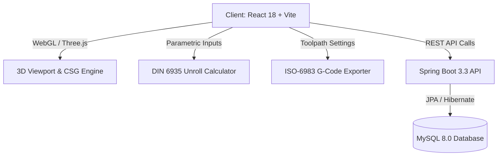

# Zahiri Metal — Enterprise 3D Tube CAD & Fiber Laser Cutting Studio 🚀

<div align="center">

[](https://reactjs.org/)
[](https://spring.io/projects/spring-boot)
[](https://www.mysql.com/)
[](https://threejs.org/)
[]()

<p align="center">
  <b>Industrial-grade, full-stack 3D parametric CAD studio engineered for CNC fiber laser tube cutting machinery.</b><br>
  Built with React Three Fiber, Constructive Solid Geometry (CSG), DIN 6935 unroll sheet algorithms, and ISO-6983 G-code toolpath generation.
</p>

</div>

---

## 🌟 Key Capabilities

- **🌐 Real-Time 3D CSG Boolean Solid Engine**:
  - Parametric Tube Profiles: Round (tube diameter $\varnothing$), Square (box tube), and Rectangular extrusions with customizable wall thickness.
  - Interactive Hole & Slot Punching: Live boolean subtraction of complex shapes onto curved 3D tube geometry using Three.js & CSG.
- **📐 DIN 6935 Unroll Sheet Computation**:
  - Accurate neutral-axis unrolling for manufacturing sheet metal preparation.
- **⚡ ISO-6983 G-Code Toolpath Generation**:
  - High-precision automated G-code generation ready for industrial laser cutters (Trumpf, Bystronic, Mazak).
- **🛡️ Enterprise Architecture**:
  - High-performance Spring Boot 3.3 backend REST API.
  - Persistent CAD project state and parametric feature trees stored in MySQL.

---

## 🏗️ Architecture Overview



---

## 🚀 Getting Started

### Prerequisites
- **Node.js**: v18.0 or higher
- **Java JDK**: 17 or higher
- **MySQL Server**: 8.0+

### 1. Backend Setup
```bash
cd backend
mvn clean install
mvn spring-boot:run
```

### 2. Frontend Setup
```bash
cd frontend
npm install
npm run dev
```

Visit `http://localhost:5173` to explore the 3D CAD canvas.

---

## 👨‍💻 Author

**Omar Torbi** — Full-Stack Engineer & Software Architect
- 🌐 **Portfolio**: [omartorbi.engineer](https://www.omartorbi.engineer)
- 💼 **LinkedIn**: [linkedin.com/in/omar-torbi](https://www.linkedin.com/in/omar-torbi-b8340933a/)
- 🐙 **GitHub**: [@TORBIomar](https://github.com/TORBIomar)
- ✉️ **Email**: [torbi.dev@outlook.com](mailto:torbi.dev@outlook.com)
